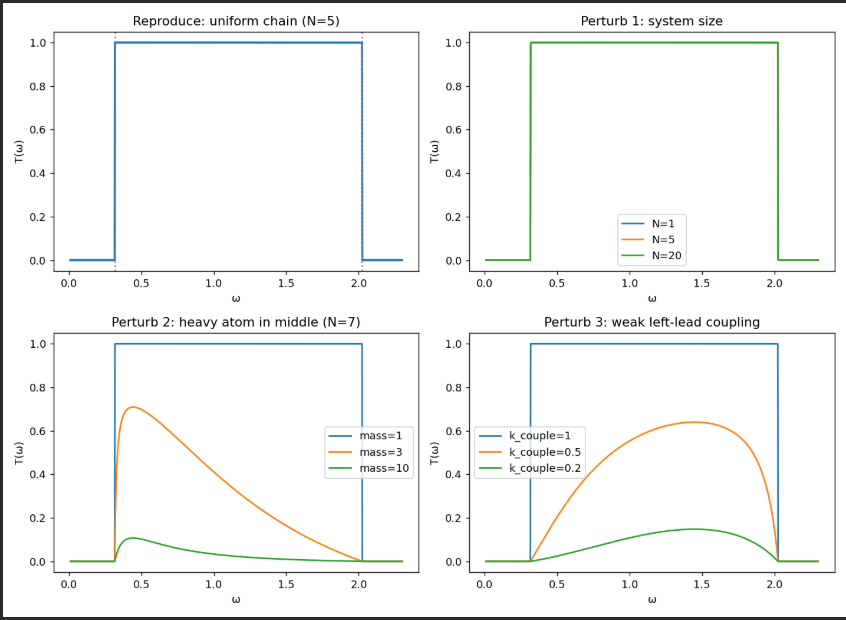
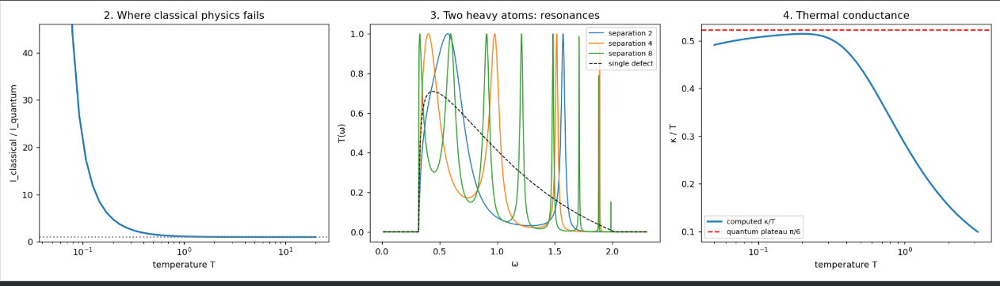

*Notes on Wang, Agarwalla, Li and Thingna, "Nonequilibrium Green's function method for quantum thermal transport" (2013). [arXiv:1303.7317](https://arxiv.org/abs/1303.7317)*

## The question

Take a short chain of atoms and attach it to a hot reservoir on the left and a cold one on the right. Heat flows through. How much, and why? The paper builds a method (nonequilibrium Green's functions, NEGF) that answers this for vibrations (phonons), and shows how the answer reduces to a simple formula when the chain is made of ideal springs.

## Why a plain average is not enough

A quantum average has a forward half and a backward half:

$$\langle O(t)\rangle = \langle \psi_0 | U^\dagger(t,t_0)\, O\, U(t,t_0) | \psi_0 \rangle$$

The state evolves forward from the known starting time $$t_0$$ to $$t$$, we measure, and then we evolve backward to compare with the known start. In equilibrium the backward leg can be dropped. With heat flowing, the system never returns to where it started, so both legs must be kept. Drawing them as one forward-and-back loop in time gives the **Keldysh contour**, and the correlations on that loop are organized into one matrix of Green's functions.

## The ingredients, in plain words

- **$$G^r$$ (retarded):** how the chain responds to a kick. This depends only on the springs and masses, not on temperature.
- **$$G^<$$ (lesser):** how much thermal jiggling is actually present. Temperature enters here.
- **$$\Sigma$$ (self-energy):** the whole effect of an infinite lead on the chain, packed into one matrix at the contact atom. Its imaginary part is leakage, since vibrations escape into the lead.

The working formula for the response of a center region is

$$G^r[\omega] = \left[(\omega + i\eta)^2 - K^C - \Sigma^r\right]^{-1}$$

where $$K^C$$ is the spring matrix of the center and $$\eta$$ is a tiny positive number that enforces cause-before-effect.

## From response to heat current

For a chain of ideal springs, the heat current has a Landauer-like form:

$$I_L = \int_0^\infty \frac{d\omega}{2\pi}\, \hbar\omega\, T(\omega)\,\big[f_L(\omega) - f_R(\omega)\big]$$

Here $$\hbar\omega$$ is the energy per phonon, $$f_L - f_R$$ is how much more the hot side has than the cold side, and $$T(\omega)$$ is the probability that a phonon of frequency $$\omega$$ gets across:

$$T(\omega) = \mathrm{Tr}\big(G^r \Gamma_L G^a \Gamma_R\big), \qquad \Gamma_\alpha = i(\Sigma^r_\alpha - \Sigma^a_\alpha)$$

Two built-in checks: if the two temperatures are equal then $$f_L = f_R$$ and the current is zero, and for a uniform chain nothing reflects, so $$T = 1$$ across the band.

## Reproducing the paper's result

I built a uniform chain (spring constant $$k=1$$, onsite spring $$k_0=0.1$$, units with $$\hbar = k_B = 1$$) and computed $$T(\omega)$$ from the formulas above.

*Transmission is 1 across the band $$\sqrt{k_0} < \omega < \sqrt{4k+k_0}$$, which is $$0.316 < \omega < 2.025$$ here, and about $$10^{-10}$$ outside it. Adding atoms to the center changes nothing, since a perfect chain does not reflect.*

## what if?

**One heavy atom.** A single atom with mass 3 or 10 in the middle pulls $$T$$ well below 1, and it hurts high frequencies the most, because a heavy atom cannot follow fast vibrations. It acts as a defect that reflects waves.

**Weak contact.** Weakening the spring between the lead and the center also lowers $$T$$, since most waves bounce off the mismatched contact.

**Two heavy atoms.** One defect gives a smooth dip. Two give sharp peaks that reach $$T=1$$, and in my runs the number of peaks matched the separation between the defects (2, 4 and 8 peaks for separations 2, 4 and 8). The stretch between the defects acts like a cavity: a wave gets through perfectly only at frequencies that fit inside it, like the etalon in optics.

**Swapping hot and cold.** Exchanging the temperatures flips the sign of the current and leaves its size unchanged ($$+0.2546$$ and $$-0.2546$$ in my run). A chain of ideal springs cannot act as a heat diode. Rectification needs nonlinearity, which the paper treats in a later section.

**Quantum versus classical occupation.** Replacing the Bose-Einstein function with its classical form $$k_BT/\hbar\omega$$ is accurate at high temperature (ratio 1.000 at $$T=20$$) but overestimates the current by a factor of about 337 at $$T=0.05$$. At low temperature the high-frequency modes are frozen out, so the particle nature of phonons matters there.

**Thermal conductance.** At low temperature, with the band reaching almost to zero frequency, $$\kappa/T$$ approaches a plateau. I measured about 0.509 against the predicted $$\pi/6 \approx 0.524$$ in these units. This is the quantum of thermal conductance, a value that does not depend on the material. At high temperature $$\kappa$$ saturates near the classical ceiling (0.313 measured, 0.318 predicted).

## What this model leaves out

Everything here is harmonic, so phonons never scatter off each other. That is why $$T(\omega)$$ is exactly 1 for a perfect chain and why the device cannot rectify. The paper extends the method to nonlinear centers with a self-consistent mean-field approximation, which is where a thermal diode would first become possible. I have not tried that yet.

## Code

The notebook that produces every figure here is on [Colab](https://colab.research.google.com/drive/1K450F73xufjLhoUaONjG9o7tKmdUX6yl#scrollTo=vpO4Q_FEdT88).
